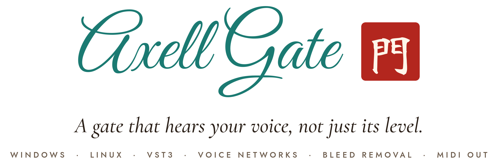
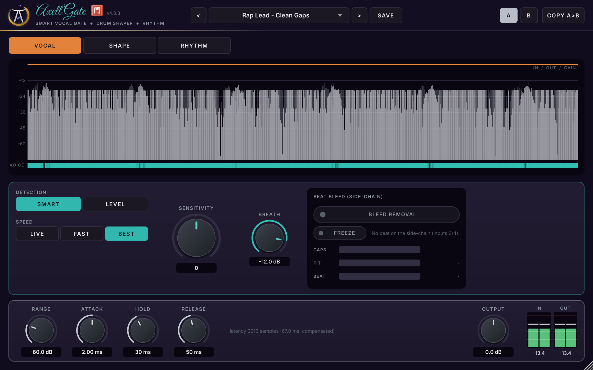
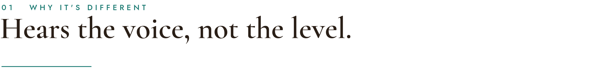
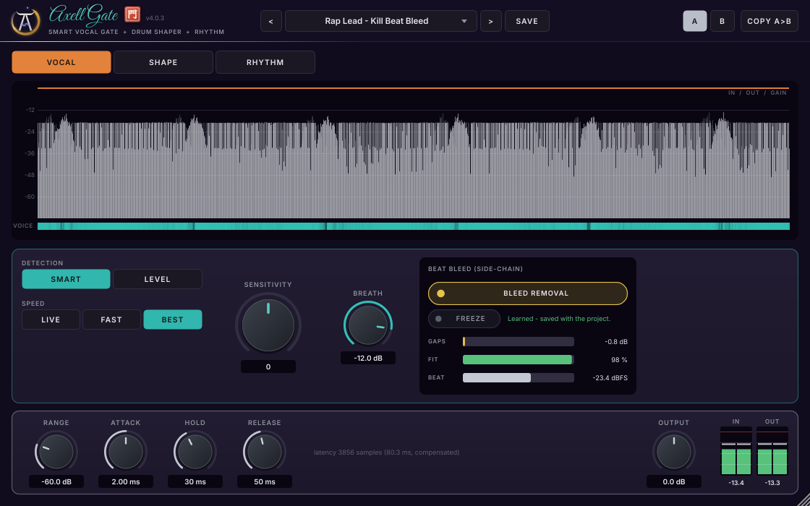
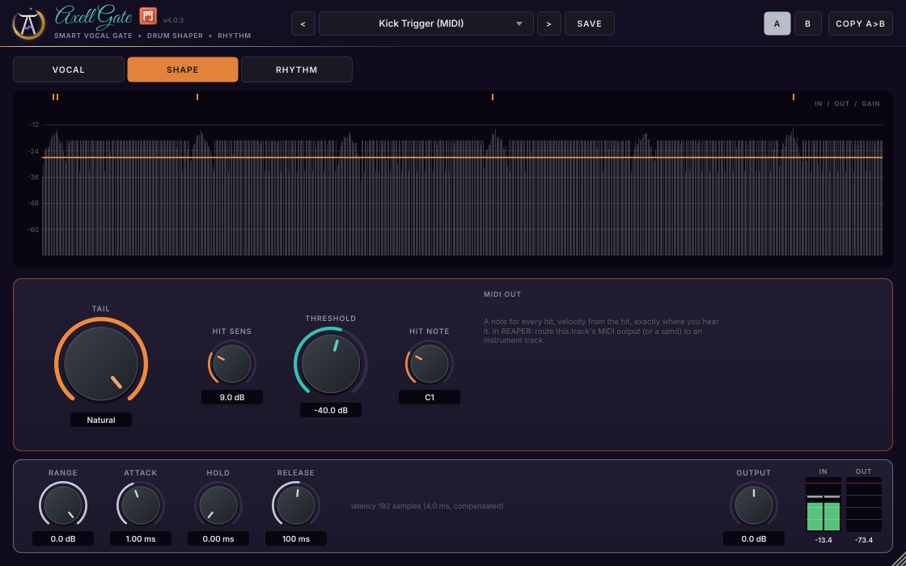
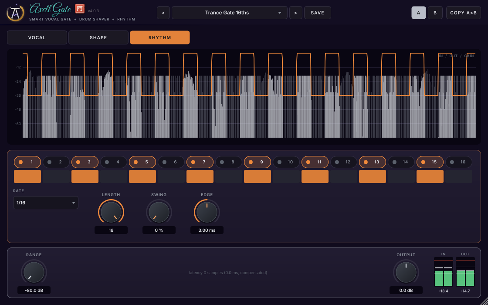
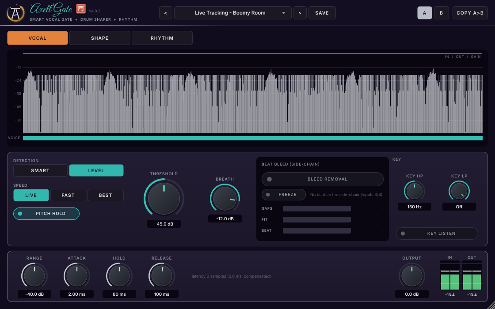
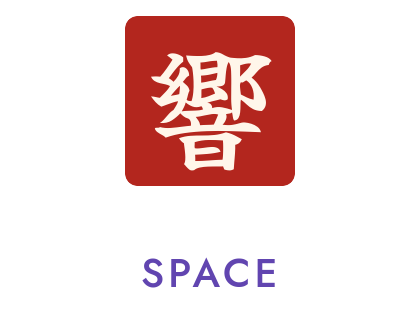
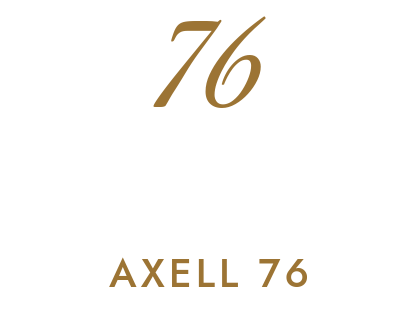

<picture>
  <source media="(prefers-color-scheme: dark)" srcset="docs/img/type/hero-dark.png">
  
</picture>

  
  
  
  
  
  

  

  <b>Most gates open on level. Axell Gate opens on <i>your voice</i>.</b> 
  Two voice networks trained on 111 voices tell a word from a breath, a breath from the room, and the room from the beat bleeding out of your headphones - then remove what isn't you, in the gaps and under the voice.

  <a href="https://github.com/zmardanian/axell-gate/releases/latest"><picture>
  <source media="(prefers-color-scheme: dark)" srcset="docs/img/type/dl-windows-dark.png">
  
</picture></a>
  &nbsp;&nbsp;
  <a href="https://github.com/zmardanian/axell-gate/releases/latest"><picture>
  <source media="(prefers-color-scheme: dark)" srcset="docs/img/type/dl-linux-dark.png">
  
</picture></a>

Free and open source (AGPL-3.0)  ·  Windows 10 / 11 and Linux  ·  any VST3 host - FL Studio, Ableton Live, Cubase, Studio One, Bitwig, REAPER

 

<picture>
  <source media="(prefers-color-scheme: dark)" srcset="docs/img/type/h-why-dark.png">
  
</picture>

- **7.7 dB less damage to the voice** - than a classic gate whose every setting was searched per take - a perfect engineer - at equal background removal.
- **Takes the beat out of your vocal** - beat on the side-chain: gaps 11-15 dB cleaner, 10-13 dB of headphone bleed removed <i>under</i> the voice.
- **Never cuts a soft syllable** - PITCH HOLD keeps the zero-latency gate open while the voice is still pitched.
- **A drum shaper with MIDI out** - SHAPE shortens tails with 10-55 dB less click than a release, and sends one MIDI note per hit, within 3 ms.
- **Featherweight** - VOCAL mode 1.5 % of one core; SHAPE and RHYTHM under 0.2 %.

 

<picture>
  <source media="(prefers-color-scheme: dark)" srcset="docs/img/type/h-does-dark.png">
  
</picture>

The gate of the Axell suite, built for vocals and beats:
- **VOCAL** opens on your voice, not on a level. It keeps every word start, sets breaths to the level you choose,
  hears your room (it tells the voice from the room ringing on after it) and, with the beat on its side-chain,
  removes the beat's headphone bleed in the gaps *and* under the voice.
- **SHAPE** shortens drum tails without clicks and without the kink a release puts in a decay.
- **RHYTHM** chops on the host's grid with click-free edges.

**VOCAL**
- **SMART** detection: no threshold to set; the same setting works on a whisper and a shout. Four parts:
  - **Two voice-activity networks** (3.0): 2.0's, trained on 27 voices with headphone bleed, room noise, rumble,
    untreated-room reverberation, compression and breaths, decides wherever it is sure; on doubtful frames a second
    network, trained on 111 voices, must agree. Far less voice lost on voices it never heard, fewer false openings.
  - **Room model:** learns your room's reverb time by itself, so the tail after a word is not taken for voice.
  - **Pause model:** knows that a 40 ms closure inside a word is not a pause.
  - **Decision:** a hidden Markov model over a short look-ahead.
- **SPEED**: BEST (67 ms latency), FAST (42 ms), LIVE (0 ms, a classic level gate for monitoring while you record).
- **SENSITIVITY**: opens more or less readily.
- **BREATH**: how loud breaths stay (removed .. untouched).
- **BLEED REMOVAL**: route the beat into the side-chain input. A frequency-domain Kalman filter learns how the beat
  leaks from your headphones into the mic and subtracts it. It never needs a threshold and never adds bleed (a safety
  check scales it down when the estimate does not fit). What it learned is saved with the project. The meter shows
  how much quieter the gaps are (GAPS), how well the learned leak fits (FIT) and the beat's level. FREEZE keeps what
  it learned.
- **LEVEL** detection (and LIVE): KEY HP / KEY LP filter what the level detector hears; KEY LISTEN lets you hear it.

**SHAPE** (programmed drums, samples, 808s)
- **TAIL**: decay scaling. The gain follows each hit's own envelope, g = (e / e_peak)^alpha, so an exponential tail
  stays exponential, just faster. TAIL 50 % = half as long, same shape, no click. The opening ramp ends exactly at the
  onset (look-ahead), even on a hit that lands on the previous one's ringing tail.
- **THRESHOLD**, **HIT SENS**, **ATTACK**, **HOLD**, **RELEASE** (the final close), **RANGE**.
- **MIDI out**: a note for every hit (HIT NOTE; velocity from the hit), exactly where you hear the hit. Layer a
  sample, or drive a synth from the drums.

**RHYTHM**
- 16 steps, each with its own level (LENGTH 2-16; 12 for triplet bars), RATE 1/4 to 1/32 and triplets, SWING, EDGE
  (raised-cosine edges centred on the grid), RANGE.
- It follows the host's tempo and position; stopped, it free-runs.

There are 25 factory presets (vocals, drums, rhythm), user presets and A/B. Projects and presets from 1.0 load.

<table>
<tr><td align="center" width="50%"> BLEED REMOVAL - the beat on the side-chain</td><td align="center" width="50%"> SHAPE - drum tails, MIDI out</td></tr>
<tr><td align="center" width="50%"> RHYTHM - gating on the grid</td><td align="center" width="50%"> LEVEL detection with the key filter</td></tr>
</table>

 

<picture>
  <source media="(prefers-color-scheme: dark)" srcset="docs/img/type/h-new-dark.png">
  
</picture>

### What's new in 4.0

- **PITCH HOLD** for the level gate (LEVEL detection and the zero-latency LIVE gate): while your voice is still pitched,
  the gate stays open even when a soft syllable or a word's voiced ending dips under the threshold. On the artist's 28
  takes through their session's LIVE gate: **42 % fewer voiced moments cut** (1.33 -> 0.77 %), pauses closed exactly
  as before, no latency, +0.07 % CPU. Projects from 3.x load with it off and sound as they did (DECISIONS G25).
- **Version in the header**, small and quiet after the title.

### What's new in 3.0

- **Two voice networks**: 2.0's network decides wherever it is sure of a voice; on doubtful frames a second network,
  trained on 111 voices (108 VCTK voices with forced-aligned labels, from Axell Velvet 3.0's research), must hear a
  voice too. On voices neither network trained on: **12.4 dB less voice lost** and a third of the missed voice; on the
  artist's dry setup, false openings 1.88 -> 0.22 %; background 3.3 dB lower on the held-out wide benchmark. The
  artist's own takes keep 2.0's voice (DECISIONS G23).
- **The suite's shared voice detector**: Gate's detector now lives in the shared core, bit-identical; Axell Duo
  Compressor 3.0 and Axell Master 3.0 use it for VOICE HOLD.
- **Axell's Dojo look**: the family emblem, a brush-written title with Gate's seal (門, "gate"), an indigo ground.

More screens: [BLEED meter](docs/screenshots/gate-bleed.png), [LEVEL key](docs/screenshots/gate-level-key.png), [SHAPE with MIDI](docs/screenshots/gate-shape-midi.png), [RHYTHM step levels](docs/screenshots/gate-rhythm-levels.png).

 

<picture>
  <source media="(prefers-color-scheme: dark)" srcset="docs/img/type/h-measured-dark.png">
  
</picture>

| | |
|---|---|
| VOCAL vs a classic level gate whose threshold, look-ahead, hold and release were searched for every take (a perfect engineer), at equal background removal | BEST: 7.7 dB less damage to the voice on average (and less in every take), 15.6 dB less to word starts. FAST: 7.3 / 7.4 dB less. In a bare untreated room: 11.8 dB less. One fixed setting, no tuning. |
| VOCAL on 24 takes in 8 recording conditions, never used for tuning (voices held out) | 3.0: voice energy removed -62 dB; open in 2.4 % of the pause time; background left -38 dB. (2.0: -63 dB, 2.8 %, -35 dB; 1.0's three voices, no room model: -50 dB, 5.4 %, -25 dB.) |
| VOCAL on 6 voices no network trained on (8 conditions) | 3.0: voice energy removed -67 dB, missed voice 0.12 % (2.0: -55 dB, 0.33 %) |
| The artist's own setup (their room, mic, preamp, real beat as bleed) and 10 real takes | 3.0: false openings 4.4 % (dry: 0.2 %), open in 24 % of the gaps of the real takes; the voice kept as in 2.0 |
| A real dry rap take from a bare room | open in 5 % of the true gaps (1.0: 80 %), word starts intact (-46 dB) |
| BLEED (beat on the side-chain) | gaps 11-15 dB cleaner, speech 13 dB cleaner than the gate alone; 10-13 dB of bleed removed under the voice; a reopened project cancels from the first second (36 dB vs 10 dB) |
| SHAPE MIDI | one note per hit, within 3 ms of the hit, velocity following the hit's level |
| SHAPE vs a classic release tuned to the same tail length | 10-55 dB less click (splatter) on kick, 808, tom, snare, clap; the tail's shape stays natural; TAIL 50 % = 0.47-0.51 x the length |
| RHYTHM | edges centred on the grid within a sample; splatter -94 dB (0.5 ms edges) to -139 dB (10 ms) |
| Silence in | exactly silence out (all modes, 44.1 / 48 / 96 kHz) |
| Host bypass | exactly the input, delayed by the reported latency |
| CPU (48 kHz stereo, one core) | VOCAL 1.5 %, with BLEED 3.3 %, SHAPE 0.18 %, RHYTHM 0.13 % (4.0.1) |
| Real-time safety | no allocation, lock or I/O in the audio path (allocation counter in the test suite) |

All of these come from:
- the research benchmarks in `research/` (CMU ARCTIC takes with known bleed, noise and breaths; held-out voices);
- the automated suites in `tests/`: 278 DSP checks at three sample rates and 104 plugin checks;
- an independent black-box audit through a VST3 host (`tests/independent/gate_audit.py`, 42 checks);
- AddressSanitizer + UBSan;
- pluginval at strictness 10;
- Steinberg's VST3 validator (47/47).

The reasoning behind every design choice is in [docs/DECISIONS.md](docs/DECISIONS.md).

**Known limits** (details in DECISIONS G21):
- In a very live room (RT60 0.5 s and more), the room's tail after a word is released 0.15-0.25 s after the word.
- With heavy compression *and* loud headphone bleed, the background can sit within ~20 dB of the voice. Very quiet
  parts of a word may then dip; route the beat to the side-chain (BLEED) there.

 

<picture>
  <source media="(prefers-color-scheme: dark)" srcset="docs/img/type/h-install-dark.png">
  
</picture>

### Windows

> [!TIP]
> **The whole suite in one go:** the [Axell Signature Suite installer](https://github.com/zmardanian/axell-signature-dojo/releases/latest) puts every Axell plugin and the Dojo on Windows 10 / 11 in one step, each one optional - and the Dojo keeps them up to date. Every VST3 host loads them: FL Studio, Ableton Live, Cubase, Studio One, Bitwig, REAPER.

Windows 10 / 11, 64-bit. Download `AxellGate-<version>-windows-x64.tar.gz` from the
[latest release](https://github.com/zmardanian/axell-gate/releases/latest) (optional: check it against `SHA256SUMS.txt`),
extract it (Windows 11 opens .tar.gz directly; on Windows 10 use 7-Zip or `tar -xzf` in a terminal) and copy the folder
`Axell Gate.vst3` into `C:\Program Files\Common Files\VST3`. Then rescan plugins in your DAW.
Or install the whole suite in one go with the Axell Signature Suite installer from the
[Axell Signature Dojo releases](https://github.com/zmardanian/axell-signature-dojo/releases/latest) - the Dojo then keeps it up to date.

Your own presets are kept in `%APPDATA%\AxellGate\Presets`.

Every Windows build is made by GitHub Actions from this repository, passes the same test suites and pluginval
(strictness 10) as the Linux build, and is checked to sound the same as it (largest difference far below -90 dBFS,
most often bit-identical). The plugin is not code-signed yet; DAWs load it directly.

### Linux

Download `AxellGate-4.0.2-linux-x86_64.tar.gz` from the
[latest release](https://github.com/zmardanian/axell-gate/releases/latest) (optional: `sha256sum -c SHA256SUMS.txt`), then:

    tar xzf AxellGate-4.0.2-linux-x86_64.tar.gz
    cd AxellGate-4.0.2-linux-x86_64
    ./install.sh

Or let the [Axell Signature Dojo](https://github.com/zmardanian/axell-signature-dojo) install and update it.

Then in REAPER: Options > Preferences > Plug-ins > VST > Re-scan. For BLEED REMOVAL, send the beat's track to the
vocal track on channels 3/4 and, in the plugin's pin connector, connect inputs 3/4 to the side-chain.

 

<picture>
  <source media="(prefers-color-scheme: dark)" srcset="docs/img/type/h-history-dark.png">
  
</picture>

| Version | Date | Engineering | Measured |
|---|---|---|---|
| **1.0.0** | 2026-10-16 | VOCAL: voice-activity network (3 voices) + fixed-lag HMM + loud evidence; BLEED (frequency-domain Kalman canceller with the beat on the side-chain); SHAPE (decay scaling with look-ahead); RHYTHM (16 steps, host sync); 21 presets | on a real dry rap take from a bare room (measured during 2.0's validation): open in 80 % of its true gaps - the reason for 2.0 |
| **2.0.0** | 2026-10-16 | Validated on a real dry rap take and rebuilt: a room model (the room's tail is not voice), 27 training voices + real-room conditions, a pause-length model, a 60 Hz detector high-pass, early openings / timed closings, BLEED saved with the project, SHAPE MIDI out, step levels, KEY filters | 24 held-out takes: 13.7 dB less voice removed, half the false openings, 10 dB more background removed; the real take: open in 5 % of its gaps (1.0: 80 %); vs the perfect-engineer classic gate: 7.7 dB less voice damage |
| **3.0.0** | 2026-10-26 | A second network trained on 111 voices (forced-aligned labels from Axell Velvet's research), consulted where 2.0's is unsure; the detector moved into the shared core (bit-identical) for Duo's and Master's VOICE HOLD; Axell's Dojo look | Unseen voices: voice lost -54.8 -> -67.2 dB, missed 0.33 -> 0.12 %; dry setup false opens 1.88 -> 0.22 %; the artist's takes as in 2.0; 278 DSP + 104 plugin checks, ASan clean, audit 42/42, pluginval L10, validator 47/47 |
| **3.0.1** | 2026-10-26 | Faster pitch analysis in the shared core (the voice detector's pitch analysis): eight lags in registers, same summation order | Output byte-identical to 3.0.0; CPU 2.10 -> 1.91 % of one core (-9.1 %) |
| **4.0.0** | 2026-10-27 | PITCH HOLD: a causal pitch tracker (YIN on the key, 70-400 Hz) keeps the level gate open through pitched voice under the threshold; never opens it, capped 500 ms; version in the header | The artist's 28 takes, LIVE gate: voiced frames cut 1.33 -> 0.77 % (-42 %), pauses unchanged; CPU 0.23 -> 0.30 %; 3.x projects render byte-identically; 302 DSP + 110 plugin checks, ASan clean, audit 42/42, pluginval L10, validator 47/47 |
| **4.0.1** | 2026-11-15 | Faster shared core (detector flatness: one log per frame; inline FFT products) | Output byte-identical to 4.0.0 (132 renders: 25 presets + 40 random settings); CPU VOCAL 1.56 -> 1.47 %, + BLEED 3.52 -> 3.31 % of one core |
| **4.0.2** | 2026-11-15 | The name in the suite's script wordmark (Great Vibes, the plugin's colour) | Audio byte-identical to 4.0.1 (132 renders) |

Every design decision with its measurement: [docs/DECISIONS.md](docs/DECISIONS.md); all changes: [CHANGELOG.md](CHANGELOG.md).

 

<picture>
  <source media="(prefers-color-scheme: dark)" srcset="docs/img/type/h-suite-dark.png">
  
</picture>

<table>
<tr><td align="center"><a href="https://github.com/zmardanian/axell-penta-eq"><picture>
  <source media="(prefers-color-scheme: dark)" srcset="docs/img/suite/penta-eq-dark.png">
  
</picture></a> analog-matched EQ</td><td align="center"><a href="https://github.com/zmardanian/axell-duo-compressor"><picture>
  <source media="(prefers-color-scheme: dark)" srcset="docs/img/suite/duo-compressor-dark.png">
  
</picture></a> FET + opto + limiter</td><td align="center"><a href="https://github.com/zmardanian/axell-gate"><picture>
  <source media="(prefers-color-scheme: dark)" srcset="docs/img/suite/gate-dark.png">
  
</picture></a> voice-aware gate</td><td align="center"><a href="https://github.com/zmardanian/axell-dereverb"><picture>
  <source media="(prefers-color-scheme: dark)" srcset="docs/img/suite/dereverb-dark.png">
  
</picture></a> small-room de-reverb</td><td align="center"><a href="https://github.com/zmardanian/axell-velvet"><picture>
  <source media="(prefers-color-scheme: dark)" srcset="docs/img/suite/velvet-dark.png">
  
</picture></a> neural de-esser + warmth</td></tr>
<tr><td align="center"><a href="https://github.com/zmardanian/axell-master"><picture>
  <source media="(prefers-color-scheme: dark)" srcset="docs/img/suite/master-dark.png">
  
</picture></a> mastering limiter</td><td align="center"><a href="https://github.com/zmardanian/axell-space"><picture>
  <source media="(prefers-color-scheme: dark)" srcset="docs/img/suite/space-dark.png">
  
</picture></a> vocal reverb + delay</td><td align="center"><a href="https://github.com/zmardanian/axell-forbidden-seal"><picture>
  <source media="(prefers-color-scheme: dark)" srcset="docs/img/suite/forbidden-seal-dark.png">
  
</picture></a> saturation</td><td align="center"><a href="https://github.com/zmardanian/axell-76"><picture>
  <source media="(prefers-color-scheme: dark)" srcset="docs/img/suite/76-dark.png">
  
</picture></a> 1176 FET compressor</td><td align="center"><a href="https://github.com/zmardanian/axell-signature-dojo"><picture>
  <source media="(prefers-color-scheme: dark)" srcset="docs/img/suite/signature-dojo-dark.png">
  
</picture></a> the suite's home</td></tr>
</table>

Nine plugins and their home, built as one family: they share a core library, so a breakthrough in one becomes a feature of the next - the sibilance network of Velvet guards the esses in Duo, Master, Space and Forbidden Seal; Gate's voice detector holds Duo's and Master's gain through your pauses. The [Axell Signature Dojo](https://github.com/zmardanian/axell-signature-dojo) installs, updates and tunes the whole suite to your voice - on Windows from a single installer.

 

<picture>
  <source media="(prefers-color-scheme: dark)" srcset="docs/img/type/h-build-dark.png">
  
</picture>

    bash scripts/setup-toolbox.sh
    bash scripts/build.sh
    bash scripts/test.sh               # DSP + plugin suites (--quick, --asan)
    bash scripts/pluginval.sh
    bash scripts/install.sh

The DSP lives in JUCE-free headers (`Source/Engine.h`, `VoiceActivity.h`, `Canceller.h` and the shared Axell core in
`external/axell-core` or `../axell-core`, which holds the voice detector and the room model). The voice models are
generated by `research/train_gate.py` from the features of the shipping C++ code (`tools/GateFeatures.cpp`); the 3.0
benchmarks are `research/bench3_gate.py` and `research/calib3_gate.py`.

 

<picture>
  <source media="(prefers-color-scheme: dark)" srcset="docs/img/type/h-credits-dark.png">
  
</picture>

**Free forever, kept alive by you.** Axell Gate costs nothing and never will - no subscriptions, no licence keys. If it has earned a place in your mixes, you can [support the Dojo on Ko-fi](https://ko-fi.com/axellyobag) - one-time or monthly, from €3.

Axell Yobag - contact@axellsdojo.com. Issues on GitHub are welcome too.

Licence: GNU AGPLv3 (`LICENSE`); third-party components and the CMU ARCTIC and VCTK notices (training data) in
`THIRD_PARTY_NOTICES.md`. No code, data or graphics of any commercial product are used.

 

VST is a registered trademark of Steinberg Media Technologies GmbH. 1176, 1176LN, LA-2A, UADx and Universal Audio are trademarks of their respective owners. The Axell plugins are independent works, not affiliated with or endorsed by them; the names only describe what was measured and compared.
